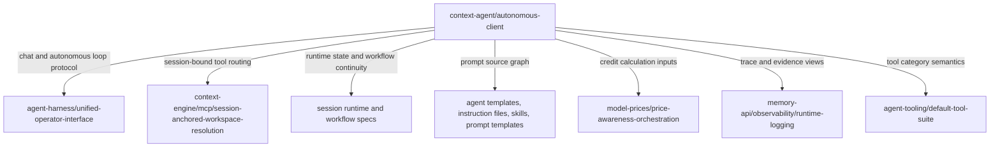

<!-- aligned-structure:v2 -->

# Context Agent Autonomous Client Product Contract

## Target Code Location

- [context-agent/README.md](../../../../context-agent/README.md) — current repository identity and starter-state note.
- [context-agent/frontend/src/main.rs](../../../../context-agent/frontend/src/main.rs) — current Dioxus frontend entry point that must become the specialized Context Agent UI.
- [context-agent/backend/src/main.rs](../../../../context-agent/backend/src/main.rs) and [context-agent/backend/src/lib.rs](../../../../context-agent/backend/src/lib.rs) — current Axum backend entry points that must expose Context Agent APIs.
- [transcripts/13-09-2026_context-agent-autonomous-client-plan/ROADMAP.md](../../../../transcripts/13-09-2026_context-agent-autonomous-client-plan/ROADMAP.md) — planning dossier that consolidated the source request and existing artifacts.

## Naming Conventions

- Component: `context-agent`.
- Spec slug: `context-agent/autonomous-client`.
- Criterion ids use the `context-agent-autonomous-client.<n>` prefix.
- User-visible product name: Context Agent.
- Code-facing nouns: `Session`, `ChatMessage`, `ModelRequest`, `ModelResponse`, `PromptAssembly`, `McpServerLifecycle`, `CreditUsage`, `ReasoningTrace`, and `AgentRun`.

## Requester Input

### Consolidate and extend Context Agent planning

> consolidate/migrate/update any existing planning and extend the specification for this goal

The request follows the planning dossier source prompt:

> Collect all planning material we already have for the Context Agent, including existing tickets, transcripts, and dossiers. The Context Agent should be an autonomous agent client with a specialized UI. The client should manage MCP tool server lifecycles, manage chat messages and requests for AI models, construct prompts using standard instruction files, agent templates, skills, and prompt templates, implement session management, display credit consumption in the frontend, and display reasoning traces and model responses.

## Reading Order

1. [transcripts/13-09-2026_context-agent-autonomous-client-plan/ROADMAP.md](../../../../transcripts/13-09-2026_context-agent-autonomous-client-plan/ROADMAP.md) — product planning source and artifact inventory.
2. [context-agent/README.md](../../../../context-agent/README.md) — current Context Agent repository state.
3. Spec `agent-harness/unified-operator-interface` (`6f286eee`) — provider contract for unified chat plus long-running autonomous loop operation.
4. Spec `context-engine/mcp/session-anchored-workspace-resolution` (`aff42efb`) — provider contract for session-bound MCP workspace resolution.
5. Spec `model-prices/price-awareness-orchestration` (`39983ddf`) — provider contract for model cost and routing awareness.
6. Spec `memory-api/observability/runtime-logging` (`aa769a27`) — provider contract for runtime diagnostics and trace/log surfaces.
7. Spec `agent-tooling/default-tool-suite` (`7c9757a7`) — provider contract for token-bounded default tool categories.
8. Spec `agent-template-roster-and-authoring-contract` (`88413517`) and spec `agent-skill-infrastructure` (`a9b7ef39`) — provider contracts for prompt construction inputs.

## Responsibility

Context Agent is the product-facing autonomous agent client. If this spec is implemented, dependents can rely on `context-agent` to provide one coherent operator surface for short chat interactions and long-running agent runs, while preserving the session, prompt, tool, model, credit, and trace identities needed to audit what happened.

The Context Agent product contract owns the client-level composition of these capabilities:

- A specialized UI for starting, inspecting, pausing, resuming, and stopping autonomous agent work.
- Chat and model-request management for human messages, constructed prompts, model requests, model responses, and typed failures.
- MCP tool server lifecycle visibility and control, bound to the active session/worktree context.
- Prompt assembly from standard instruction files, agent templates, skills, and prompt templates, with inspectable provenance.
- Session management that consumes durable session runtime, pins, workflow graph, handoff, and worktree-routing data.
- Frontend credit display derived from model-price and usage telemetry rather than a separate pricing source.
- Reasoning trace, tool trace, validation evidence, artifact, and model-response views that distinguish observed evidence from generated text.

## Interfaces And Dependencies

Context Agent consumes provider contracts rather than redefining their internals:

- `agent-harness/unified-operator-interface` provides the unified on-demand chat plus long-running loop session model.
- `context-engine/mcp/session-anchored-workspace-resolution` provides session-bound MCP call routing.
- `agent-tooling/default-tool-suite` provides tool category semantics for read, execute, edit, filesystem, and search surfaces.
- `agent-template-roster-and-authoring-contract` and `agent-skill-infrastructure` provide guidance artifacts used by prompt assembly.
- `model-prices/price-awareness-orchestration` provides model-price and routing semantics that credit display consumes.
- `memory-api/observability/runtime-logging`, `Quality gates and session data collection for delegated sessions` (`7be68a48`), and `compact-terminal: bounded command execution with spill-and-peek` (`63c60c9d`) provide trace, validation, command-output, and diagnostic evidence inputs.
- `Dynamic session bootstrapping and just-in-time context routing` (`8c880efc`) and `Durable session workflow graph and handoff continuity` (`c677182e`) provide session runtime and workflow continuity semantics.

Related execution planning is currently represented by [.workflow-tools/ticket/tickets/0f4b3c5b-c5e9-45c4-968c-a8878f359de8/ticket.toml](../../../../.workflow-tools/ticket/tickets/0f4b3c5b-c5e9-45c4-968c-a8878f359de8/ticket.toml), [.workflow-tools/ticket/tickets/3dd84de0-474a-4797-ba83-787c907ae55b/ticket.toml](../../../../.workflow-tools/ticket/tickets/3dd84de0-474a-4797-ba83-787c907ae55b/ticket.toml), [.workflow-tools/ticket/tickets/61f78a57-6896-4ad7-9daa-0e9e805aa397/ticket.toml](../../../../.workflow-tools/ticket/tickets/61f78a57-6896-4ad7-9daa-0e9e805aa397/ticket.toml), and [context-engine/context-stack/.ticket/tickets/445a2d76-5795-4d7a-aec8-d1536ec61416/ticket.toml](../../../../context-engine/context-stack/.ticket/tickets/445a2d76-5795-4d7a-aec8-d1536ec61416/ticket.toml).

## Behavior

1. A user can start or resume a Context Agent session from the specialized UI and see whether the session is in interactive chat, autonomous run, paused, blocked, completed, or failed state.
2. The UI shows chat messages, constructed prompts, model requests, model responses, typed failures, and final artifacts as separate but correlated records within one session timeline.
3. Prompt assembly shows which instruction files, agent templates, skills, and prompt templates contributed to a model request, including source identity and inclusion reason.
4. MCP tool server lifecycle controls and status views are session-aware; a tool server start, stop, reload, or failure is tied to the active session/worktree routing context.
5. Credit consumption is displayed from recorded model identity and token/cost telemetry, including input, output, cache-read, and cache-write contributions when available.
6. Reasoning traces, command/tool traces, validation output, model responses, and final artifacts are visibly different evidence classes. A model response alone is never presented as proof that a command ran, a file changed, or a validation gate passed.
7. The frontend and backend preserve enough identifiers for traceability: `session_id`, run id, message id, model request id, tool call id, prompt assembly id, provider/model id, and artifact/evidence ids.

## Boundaries And Failure Cases

- Context Agent must not duplicate provider-owned state for sessions, model prices, MCP workspace resolution, or observability. Context Agent may cache or project these records for UI performance only when the source identity and refresh status remain visible.
- Context Agent must not expose raw credential material, provider secrets, or hidden system prompts in frontend state or logs.
- When provider telemetry is missing, the UI must show an explicit unknown or partial state rather than fabricating token cost, trace completeness, or successful execution.
- When an MCP tool server cannot be resolved to the active session/worktree context, lifecycle actions must fail with an actionable diagnostic instead of falling back to the process working directory.
- When prompt inputs conflict or are stale, prompt assembly must record the conflict and block the model request or require an explicit override rather than silently dropping guidance.
- When a long-running agent run disconnects from the browser, the durable session timeline remains the source of truth and the reconnecting UI resumes from recorded state.

## Provider/Consumer Contract
-
The implementation ticket set is recorded in the spec metadata and has canonical references in the planning roadmap: [CA-01 timeline contract](../../../../.workflow-tools/ticket/tickets/8b78c940-7c63-412b-8d4c-051a32f573f9/ticket.toml), [CA-02 prompt provenance](../../../../.workflow-tools/ticket/tickets/1ef56eb5-a957-45a0-981b-83acda2f9d89/ticket.toml), [CA-03 session-bound MCP](../../../../.workflow-tools/ticket/tickets/1e24734a-189b-4c66-af68-277c9f224687/ticket.toml), [CA-04 credit telemetry](../../../../.workflow-tools/ticket/tickets/f1553f84-cdbe-4ff1-9d2a-4380b17bcc5f/ticket.toml), [CA-05 evidence classes](../../../../.workflow-tools/ticket/tickets/b32bf927-cd98-4bef-8b8b-9e5883a77fda/ticket.toml), [CA-06 redaction boundary](../../../../.workflow-tools/ticket/tickets/d3335184-5abc-4069-868e-777432c9d33b/ticket.toml), and [CA-07 durable reconnect](../../../../.workflow-tools/ticket/tickets/be1ed61e-f163-461e-9e36-acdf059a16b9/ticket.toml). Phase 1 also depends on [ticket lifecycle reconciliation](../../../../.workflow-tools/ticket/tickets/8d0f0a2f-969d-48d7-a5f7-8a6ee9a90284/ticket.toml).

## API Contract Before Implementation

Phase 1 implementation must use the following product-facing HTTP contract. The exact Rust type names may change during CA-01 implementation, but field meaning and identifier requirements are normative.

| Method and path | Request | Response | Required behavior |
|---|---|---|---|
| `POST /api/sessions` | `{ "mode": "chat" | "autonomous", "worktree_id": string }` | `{ "session_id": string, "state": string }` | Create or resume a session-bound client session; never select a process-directory fallback. |
| `GET /api/sessions/{session_id}/timeline` | Path `session_id` | `{ "session_id": string, "events": [TimelineEvent] }` | Return durable correlated events ordered by recorded sequence. |
| `POST /api/sessions/{session_id}/messages` | `{ "message_id": string, "content": string, "agent_template_id": string? }` | `{ "message_id": string, "prompt_assembly_id": string, "model_request_id": string }` | Record the human message and create the prompt/model correlation. |
| `POST /api/sessions/{session_id}/mcp-servers/{server_id}/lifecycle` | `{ "action": "start" | "stop" | "reload" }` | `{ "event_id": string, "state": string, "diagnostic": string? }` | Resolve the active session/worktree before action; unresolved routing fails closed. |

`TimelineEvent` requires `event_id`, `session_id`, `run_id?`, `message_id?`, `model_request_id?`, `tool_call_id?`, `prompt_assembly_id?`, `provider_model_id?`, `evidence_kind`, `sequence`, `state`, and `source_id?`. `evidence_kind` is one of `chat_message`, `prompt_assembly`, `model_request`, `model_response`, `tool_call`, `reasoning_trace`, `validation`, `artifact`, or `failure`. Responses expose redacted projections only.

CA-01 must add contract tests for the endpoint shapes and identifier correlation before CA-02 or CA-03 can become implementation-ready. Phase 1 uses Playwright E2E checks for the browser-visible timeline and session flow; Phase 2 uses the same suite for credits, evidence classes, redaction, and reconnect.

The product/API ownership boundary is explicit: `context-agent/backend` owns
Context Agent composition APIs, DTOs, timeline projections, and redacted read
models; `context-agent/frontend` owns presentation and interaction state.
Provider crates remain authoritative for session/worktree routing, MCP
execution, prompt-input discovery, model pricing and token telemetry, durable
traces, validation evidence, and artifacts. Context Agent consumes provider
contracts through adapters or projections, preserving source ids and partial
status. Missing provider capabilities become dependency tickets rather than
duplicated Context Agent state or process-directory fallbacks.

Provider-owned criteria remain owned by their provider specs. This Context Agent spec owns only the product-level composition and UI/API obligations that make those provider contracts usable from `context-agent`.

## Examples

### Example: Prompted autonomous run with visible provenance

A user opens the Context Agent UI, starts a session, selects an agent template, and asks for a repository task. The backend creates a `ChatMessage`, assembles a prompt from the selected agent template plus applicable instruction files and skills, records a `PromptAssembly`, sends a `ModelRequest`, and streams `ModelResponse` events into the session timeline. The UI shows the chat text, prompt-input provenance, model identity, response status, and any tool calls emitted by the agent run as separate timeline entries linked by ids.

### Example: MCP lifecycle failure under session routing

A user tries to start an MCP tool server for a session whose worktree assignment cannot be resolved. Context Agent refuses the lifecycle action, shows the unresolved `session_id` and expected workspace binding, and does not start the server from the process working directory. The failed lifecycle event is recorded in the session timeline as a typed failure.

### Example: Partial credit telemetry

A model response arrives with model identity and output tokens but no cache-read token count. Context Agent computes the known portion of the credit usage, marks cache-read usage as unknown, and keeps the trace link to the original telemetry source so downstream review can distinguish measured usage from missing data.

## Evidence

### Positions

- [context-agent/README.md](../../../../context-agent/README.md): `partial` — repository exists and documents that product-specific feature work has not started.
- [context-agent/frontend/src/main.rs](../../../../context-agent/frontend/src/main.rs): `not-implemented` — current frontend is the template echo UI.
- [context-agent/backend/src/main.rs](../../../../context-agent/backend/src/main.rs): `not-implemented` — current backend is the template Axum startup path.
- [context-agent/backend/src/lib.rs](../../../../context-agent/backend/src/lib.rs): `not-implemented` — current backend API is still template behavior until verified otherwise by implementation work.
- [transcripts/13-09-2026_context-agent-autonomous-client-plan/ROADMAP.md](../../../../transcripts/13-09-2026_context-agent-autonomous-client-plan/ROADMAP.md): `implemented` as planning evidence — the dossier exists and consolidates the product goal.

### Guards

- `context-agent-autonomous-client.spec-links`: `spec refs validate` or equivalent spec-health command must confirm that this spec's linked specs, tickets, and code paths resolve.
- `context-agent-autonomous-client.frontend-contract`: a future UI validation must prove the frontend displays sessions, chat/model requests, prompt provenance, credits, traces, and model responses as distinct correlated records.
- `context-agent-autonomous-client.backend-contract`: a future backend validation must prove the API preserves session/message/request/tool/prompt/cost/trace identities without exposing secrets.
- `context-agent-autonomous-client.provider-parity`: future integration validation must prove Context Agent consumes provider contracts for sessions, MCP routing, model prices, guidance artifacts, and observability rather than duplicating those sources of truth.

### Acceptance Criteria

Implementation ticket seeds and exact validation obligations are maintained in
[05-delivery-plan.md](../../../../transcripts/13-09-2026_context-agent-autonomous-client-plan/05-delivery-plan.md).
The `/tickets` workflow must materialize one durable ticket per seed before
implementation and preserve the listed provider dependencies.

1. `context-agent-autonomous-client.1`: Context Agent provides one UI session timeline that correlates chat messages, model requests, model responses, tool calls, prompt assemblies, traces, validation evidence, and final artifacts by durable ids.
2. `context-agent-autonomous-client.2`: Prompt construction records every included standard instruction file, agent template, skill, and prompt template with source identity, version or path where available, and inclusion reason.
3. `context-agent-autonomous-client.3`: MCP tool server lifecycle actions are tied to the active session/worktree context and fail closed with diagnostics when that context is unresolved.
4. `context-agent-autonomous-client.4`: Credit display is derived from recorded model identity and token/cost telemetry and marks missing telemetry explicitly.
5. `context-agent-autonomous-client.5`: Reasoning traces, model responses, command/tool traces, validation output, and final artifacts are visually and structurally distinct evidence classes.
6. `context-agent-autonomous-client.6`: Frontend state and logs do not expose raw credential material, provider secrets, or hidden prompt content not explicitly approved for display.
7. `context-agent-autonomous-client.7`: Reconnecting to an active or completed long-running session reconstructs state from durable session records rather than browser-local memory alone.

### Governing Rule Requirement

A future Context Agent guidance rule must introduce this spec as `coming-soon / not-implemented` until implementation evidence satisfies the guards above. Once frontend, backend, provider-parity, and link-validation guards pass, the rule may present the spec as an implemented product contract.

## Scope

This spec defines the product-level contract for `context-agent` as an autonomous agent client. This spec does not implement code, create execution tickets, replace provider-owned session/MCP/cost/observability specs, or decide final UI layout. Execution tickets should be derived from [transcripts/13-09-2026_context-agent-autonomous-client-plan/ROADMAP.md](../../../../transcripts/13-09-2026_context-agent-autonomous-client-plan/ROADMAP.md) after this draft is accepted.
